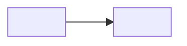

# Requests for change (RFC mode)

An RFC (Request For Change) proposes a change before it is built and asks the people
it touches for feedback. It is a shared document for every stakeholder: it says why
the change is needed, what success looks like, what we plan to build and roll out,
and what it will cost and risk. Its language invites disagreement.

This is the format for any written plan of a feature or a change. When you would
otherwise write a requirements file, a spec, a `PLAN.md` or a design doc in your own
shape, write an RFC instead. One known shape is easier to read, review and compare
than a new layout every time.

## RFC or ADR

| | RFC | ADR |
|---|---|---|
| Purpose | propose a change and ask for feedback | record one decision that was made |
| When | before building, while the change is open | after the decision |
| Scope | the whole change: problem, goals, solution, rollout, risk, cost | one decision and its tradeoff |
| Readers | every stakeholder: engineers, product, ops, support | future engineers asking "why is it like this?" |
| Edited | yes, until approved; abandoned ideas move to Abandoned Solutions | never once accepted; a new ADR supersedes |
| Size | a few pages | about one page |

They work together. An RFC usually contains several decisions; once it is approved,
offer ADRs for the ones that pass the ADR test (`adr.md`, "When to write one") and
link them from the RFC's Linked Tickets. The RFC's Abandoned Solutions table becomes
the ADR's tradeoff table. Write only an ADR when there is one decision to record and
nothing to roll out; write an RFC when people need to agree on a change before it
is built.

## When to write one

1. **On request.** `/rfc`, "write an RFC", "write a proposal", "write up the plan for
   this feature", "write the requirements/spec for this".
2. **Instead of an ad-hoc requirements file.** If you are about to write a
   requirements, spec, plan or proposal document for a feature, use this template.
   Do not invent another layout.
3. **Offered at the end of Hammock**, when the decisions add up to a change that has
   to be built and rolled out, and other people need to agree to it. Ask in one line:
   "Want this written up as an RFC?"

An RFC is not needed for a bug fix, a refactor that changes no contract, or a
change only one person owns and nobody else needs to review. The PR description is
enough there.

## Where it goes

1. Look for an existing folder first: `docs/rfc/`, `docs/rfcs/`, `rfc/`, `rfcs/`,
   `docs/proposals/`, `docs/design/`, or files matching `*rfc*`. If one exists,
   follow its numbering, file naming and status words. Keep this template's
   sections; add any the house style requires.
2. Otherwise use `docs/rfc/NNNN-short-change-slug.md`: the next free four-digit
   number and a kebab-case slug naming the change
   (`0003-stream-billing-events.md`, not `0003-billing.md`).
3. If the repo has an index (`docs/rfc/README.md` or similar), add one line for it.
4. If the person wants the RFC somewhere else (a shared doc tool, a PR description),
   write the same sections there.

## Statuses

- **Draft**: written, not yet shared for feedback. Write new RFCs as Draft.
- **In Review**: shared with stakeholders; feedback is being worked in.
- **Approved**: agreed; implementation can start. Edit only to fix facts or record
  rollout progress.
- **Rejected**: turned down. Kept, with the reason in the Conclusion.
- **Withdrawn**: the author stopped pursuing it.

The person moves the status. The skill writes Draft unless told otherwise.

## Writing each section

Keep it short. Use pictures (Mermaid diagrams) and tables where they say more than
prose. Use the real names from the code. Write as "we propose" and "we think", not
"we will"; it is a request, and the reader should feel free to push back.

Gather facts from the code, docs, tickets and the conversation first. Ask the
person only what they alone can decide (see "Gathering what you need"). Where a fact
is missing, write `?` in place and list it at the end of the Conclusion; never fill
the gap with a guess that reads like a fact.

- **Header.** `[RFC] <the change, as a short phrase>`. A status line and a Linked
  Tickets line (issues, PRs, ADRs, earlier RFCs); `none` if there are none.
- **Introduction.** Two to four sentences: what this RFC is about, why the document
  exists now, who should read it, and an explicit ask for feedback and concerns.
- **Problem Statement.** The unmet objective and its cause, not the missing feature
  ("we don't have X" is never a problem). Say why the current solution, if there is
  one, falls short, and what it costs today. Draw the current solution: a Mermaid
  diagram of today's flow or components, so readers start from the same picture.
- **Goals.** What success looks like, as observable outcomes with a metric each
  (baseline today, target, how it will be measured). Then an **Out of scope**
  subsection: what this change will not do, so nobody reviews it for something it
  never promised.
- **Solution.** The proposed design: a picture of the new flow (sequence or
  component diagram), the data model or schema changes, API changes (classify each
  change to a published interface as accretion or breakage; prefer accretion), the
  infrastructure needed, and UI/UX flows if users see it. Link specs rather than
  pasting them. Keep it simple, keep it short.
- **Abandoned Solutions.** Every other option considered, including keeping today's
  setup, with its pros and cons and the reason it was not picked. Start with a
  tradeoff table, status quo first (`tradeoff-table.md`); then one short paragraph
  per option. As the RFC evolves, ideas that get dropped move here with the reason;
  they are never deleted, because "why not X?" is the first question reviewers ask.
- **Implementation & rollout.** The steps, in order, as phases that each ship and
  can be checked on their own: what can go out first behind a flag, to a small
  share of users or a single tenant, to avoid a big-bang release and get early
  feedback. For each phase: how to roll it back, and the observability it needs
  (logs, metrics, traces, the dashboard or alert that shows it works). Close with
  the stakeholders who need to know (support, ops, other teams, customers) and what
  they should expect or may be asked.
- **Risk.** Each risk as a row: what could go wrong, who it hits, how likely and how
  bad, and the mitigation. Include risks to data (migration, loss, corruption), to
  consumers (breaking changes), and to operations (load, on-call).
- **Cost.** Total cost of ownership for the next few months: build effort,
  infrastructure, licences or vendors, migration, and the ongoing cost to run and
  maintain it. Show the arithmetic, label each number measured, inferred or assumed
  (Error Bar mode, `errorbar.md`), and compare with the cost of doing nothing.
- **Conclusion.** Summarize the key points in a few lines: the problem, the
  proposal, the main risk and the cost. End with the feedback wanted: the open
  questions and `?`s, each addressed to whoever can answer it.

## Gathering what you need

Most of an RFC can be found: the current solution, the code it touches, consumers
of the APIs, existing metrics. Look before you ask.

The person has to decide a few things only they can: the problem and why it matters
now, the goals and their targets, what is out of scope, and which option to propose.
If those are not in the conversation or the docs:

- Ask them, one question per turn, in the shape of `hammock.md`, starting with the
  problem. Stop asking once those are settled; everything else can be drafted.
- If the person says "draft" or asks for the RFC without questions, write it
  straight away with `?` where they would have answered, and list those in the
  Conclusion.

When the person hands you an existing requirements file, spec or notes, convert it:
keep every fact, move each into its section, mark what the source did not say with
`?`, and do not drop requirements because they don't fit.

## Template

````markdown
# [RFC] <The change, as a short phrase: "Stream billing events to the ledger">

| Status | Draft |
|---|---|
| Linked Tickets | <issue / PR / ADR links, or none> |

## Introduction
<Two to four sentences: what this RFC proposes, why we are writing it now, and who
should read it. Ask for feedback: "Please comment on anything that is unclear or
that you disagree with, especially <the part most likely to be contested>.">

## Problem Statement
<The unmet objective and its cause, in a few sentences. Why the current solution
falls short and what that costs today, with numbers where they exist.>

Current solution:



## Goals
| Goal | Metric | Today | Target |
|---|---|---|---|
| <observable outcome> | <how we measure it> | <baseline, or ?> | <target> |

### Out of scope
- <what this change will not do>

## Solution
<The proposal in a few sentences, then the details that apply.>

```mermaid
sequenceDiagram
  <the new flow>
```

- Data model: <tables, fields, events added or changed>
- API: <endpoints or messages added or changed; accretion or breakage>
- Infrastructure: <what is new to run>
- UI/UX: <user flow or mockup link, if users see it>

## Abandoned Solutions
<The decision being made, for which problem.>

| Criterion | Status quo: <what exists> | Proposed: <solution> | <Option C> |
|---|---|---|---|
| <most important criterion> | 🔴 ... | 🟢 ... | 🟡 ... |
| <next criterion> | ... | ... | ? |

🟢 notably good · 🟡 challenge · 🔴 blocking · ? unknown · no mark: neutral

### <Option C>
Pros: <...>. Cons: <...>. Abandoned because: <one sentence>.

## Implementation & rollout
| Phase | What ships | Exposure | Rollback | Observability |
|---|---|---|---|---|
| 1 | <first slice> | <flag / internal / 5% / one tenant> | <how> | <logs, metric, alert> |
| 2 | <...> | <...> | <...> | <...> |

Stakeholders: <who needs to know, and what they should expect or may be asked>.

## Risk
| Risk | Impact | Likelihood | Mitigation |
|---|---|---|---|
| <what could go wrong> | <who it hits, how badly> | <low/medium/high> | <step that reduces it> |

## Cost
| Item | Next 3 months | Basis |
|---|---|---|
| Build | <person-weeks> | <assumed / inferred / measured> |
| Infrastructure | <per month × months> | <...> |
| Run and maintain | <...> | <...> |
| **Total** | <sum> | |

Doing nothing costs: <the ongoing cost of the problem, for comparison>.

## Conclusion
<The problem, the proposal, the main risk and the cost, in a few lines.>

Feedback wanted:
- <open question or ?, and who can answer it>
````

## After approval

- Offer ADRs for the decisions in it that pass the ADR test, and add them to Linked
  Tickets.
- Update the rollout table's phases as they ship, if the team keeps the RFC as the
  rollout record. Do not rewrite the reasoning sections of an approved RFC: if the
  plan changes substantially, write a new RFC that links the old one.

## Reviewing an RFC

`/untangle path/to/rfc.md` reviews it like any design doc. In addition, check:

- every section is present and in the template's order, and a missing answer is
  marked `?` rather than left out;
- the Problem Statement states an unmet objective and cause, not a feature;
- each goal has a metric, and Out of scope is written down;
- Abandoned Solutions includes the status quo and gives a reason per option;
- the rollout avoids a big bang, has a rollback per phase and names its signals;
- every risk has a mitigation, and the cost numbers are labelled and add up.
